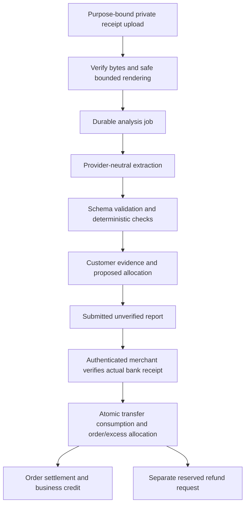

# Manual payment receipt checks and excess-payment handling

Date: 27 October 2026. Status: proposed engineering plan; implementation not started.

This plan covers the customer “I have paid” form, receipt assessment, merchant
review, duplicate-transfer protection, larger partial payments, business credit,
later-order credit application and refunds. Owner scope expanded on 27 October
2026 to include business-managed customer balances, positive-balance display on
Orders/payment links, explicit credit use and future automated banking adapters.
This remains one planning deliverable with eight proposed delivery milestones;
their scope is expanded below, implementation remains 0/8. It does not authorize
implementation, model calls with customer data, account lookups, fund movement or
deployment. Provider
capabilities below were checked against current official documentation.

## 1. Recommendation

Use AI to extract evidence from a receipt. Use deterministic server rules to
compare that evidence with the payment instructions, intended amount, order and
prior transfers. Keep the authenticated merchant responsible for confirming
money received until a separately approved bank/provider reconciliation source
exists. Only canonical financial commands can settle an order, hold customer
credit or record a refund.

The three independent questions are:

1. **Receipt assessment:** What does this attachment appear to say, and are there
   inconsistencies or signs that it was used before?
2. **Funds confirmation:** Did this business actually receive this transfer, in
   this account, for this amount and currency?
3. **Allocation:** How much of the confirmed money settles this order, and what
   happens to the remainder?

An authentic-looking screenshot, matching recipient, or printed “Successful”
status cannot establish question 2. Neither AI nor OCR can guarantee that an
image is authentic, a transfer settled, or funds were not subsequently reversed.

Recommended first release: receipt checks plus merchant review; then explicitly
reviewed order/excess allocation using the existing customer ledger. Treat a
refund request and the actual return of money as separate operations. Describe
the retained balance as **credit with this business**, rather than implying an
EwaTrade-wide, transferable or bank-held wallet.

## 2. Existing source and integration constraints

Reviewed in the current main checkout at planning baseline `7beecf387`:

| Existing area | Current behavior | Consequence for this plan |
| --- | --- | --- |
| `packages/db/prisma/models/manual-payments.prisma` | Link freezes bank instructions, currency and requested amount; report retains claim, receipt digest and merchant decision | Preserve historical snapshots; add separate assessment and allocation records |
| `packages/utils/src/manual-payments.ts` | Claim is capped at the smaller of requested amount and current order balance; fixed requests require that amount | Supporting larger claims requires explicit contract changes at prepare, submit and UI validation, not only a new UI option |
| `packages/db/src/queries/business-payment-links.ts` | Purpose-scoped reports, idempotent decisions, order/report locking; merchant confirmation writes canonical payment and refuses excess | Preserve the ordinary flow; introduce a composed excess-confirmation command rather than removing the overpayment guard |
| `apps/api/src/banking/manual-payment-receipts.ts` | Private, bounded JPEG/PNG/WebP/PDF upload with type, size and digest checks | Reuse upload authority; process only server-verified stored bytes; add safe rendering/analysis admission |
| `packages/ai/src/media.ts` | OpenAI-only image reader, with business-setup wording and schema output | Reuse provider/usage foundations, but create a purpose-specific receipt adapter; do not pass receipts through the setup prompt |
| `packages/db/src/queries/customer-ledger/receipts.ts` | Canonical held-money receipt with customer-advance accounting | Candidate building block for confirmed excess; currently uses recording time, so effective-date support needs explicit design and checks |
| `packages/db/src/queries/customer-ledger/receipt-and-apply.ts` | Applies receipts to oldest unpaid charges | Do not use this default for a payment intended for the specific linked order |
| `packages/db/src/queries/customer-ledger/refunds.ts` | Owner/Admin command returns unused held credit and records money already returned; no provider transfer | Reuse financial provenance and authority, while adding a separate customer request/reservation lifecycle |
| `packages/db/src/queries/customer-ledger/allocations.ts` and `credit-review.ts` | Reviewed, revision-bound source allocations settle eligible Order charges through `CUSTOMER_CREDIT`, without another bank collection; current commands require Finance management authority | Reuse financial invariants; add a separately authorized customer-credit use path without impersonating a merchant or relaxing management commands |
| `packages/db/src/queries/customer-ledger/commerce-locks.ts` | Finance Book → Customer account → Order lock order | Extend consistently for report, transfer and excess records; no nested transactions or network calls while holding locks |

Source presence is not evidence of current native, channel or deployed availability.
Do not mark older manual-payment acceptance gates complete through this plan.

## 3. Customer and merchant experience

### Customer form

1. “I have paid” reveals the existing inline editable payer name. Preserve the
   selected design and existing name-prefill behavior.
2. Show requested amount and remaining order balance separately. Customer enters
   **amount transferred**, optionally attaches a receipt under current attachment
   eligibility, and can submit without an attachment for manual review.
3. Upload into the existing purpose-bound draft. Begin assessment as soon as the
   stored bytes pass ingress checks. Show Checking receipt, then actionable
   findings. Use “Receipt appears consistent” rather than “Payment verified.”
4. Display extracted amount, date and masked recipient as evidence. Missing or
   unreadable fields stay unknown. If extraction disagrees with the entered
   amount, show both and offer **Use receipt amount** or **Keep my amount and ask
   the business to review**. Selecting a suggestion updates the claimed amount
   only after an explicit customer action.
5. If the amount is above the requested installment, offer **Apply more to this
   order**, subject to merchant policy and review. Show the proposed new balance.
   Do not silently change fixed-payment terms or allocate extra to unrelated debt.
6. If the proposed amount leaves excess, show its exact value and offer **Keep as
   credit with this business** or **Request a refund**. Also support **Ask the
   business to resolve this** when credit eligibility or refund details are
   unavailable. Real money must not become unreportable because setup is missing.
7. A refund request asks for bank, account number and account-holder name. Treat
   these as an unverified destination request. Do not infer payout authority from
   possession of the public payment link or from an account-name lookup.
8. Final review shows claim, proposed order allocation, estimated excess, chosen
   treatment, findings and “The business must confirm receipt.” Submit one
   idempotent report and recover the same report after refresh or network loss.

Analysis timeout must allow **Submit for manual review**. A verified upload safety
failure refuses that attachment and permits replacement or an attachment-free
claim; it must never send unsafe bytes to a model.

Run amount/excess rules even without a receipt. Attachment replacement invalidates
old assessment results and requires the customer to review any changed proposal.

### Merchant review

Show four distinct values: requested installment, customer claim, receipt reading,
and actual amount verified in the receiving bank account. Include account/date/
reference findings, duplicate candidates and their scope-authorized provenance.
The merchant enters or confirms actual receipt details; AI does not pre-confirm.

The confirmation review states exactly how much will settle the order, remain
held for the customer, or be reserved for a refund request. Larger-than-order
receipts require the existing higher Finance/customer-ledger authority, even if
the reviewer can approve ordinary Order payments. Reject a stale review and
refresh it when the order, customer, receiving account, allocation or authority
changes. Merchant corrections retain the original customer claim and extraction.

Customer receipt/check status, order payment status, credit availability and refund
status remain separate. “Order paid; refund requested” is a valid combined result.
After submission or confirmation, later AI results can add evidence but cannot
change money, decisions or allocation automatically.

### Business customer-balance management

The module owns the balance/refund experience and orchestration, using the existing
customer-ledger domain as financial authority. Each business manages each canonical
Customer's currency-specific credit, allocations, refund holds, refunds and immutable
statement. Bank accounts retain receipt/payout provenance; they do not create
separate customer wallets or duplicate the credit when more than one bank is used.
Cross-business/cross-currency spending is excluded. Cross-Store use follows the
business's existing customer/Book policy and current operator scope.

Available credit is the sum of eligible, unreversed, unallocated source funds
minus active refund and applicable review reservations, never below zero. Prevent
double subtraction by giving every allocation/reservation an exact source and
lifecycle. Update all consuming commands, including existing merchant credit
application and refunds, to honor the same reservations. Display total held,
reserved and available separately in management; customer checkout uses available.

On a saved Customer's Order, show an actionable credit row only when the authorized
available credit is positive. Hide it at a known zero balance. Unlinked customers,
unavailable data and insufficient permission are distinct from zero: show an
appropriate loading/recovery state or an authorized resolution action without
inventing a number or leaking credit existence. Keep amount still owed on the
Order distinct from credit available; do not show a net figure as spendable funds.

Finance Owner/Admin can view source entries, record actual receipts, apply eligible
credit to exact Orders, review refunds and use existing reasoned corrections.
Opening balances/adjustments remain controlled canonical commands with source
kind, permission and audit; there is no unrestricted “edit customer balance” field.
Scoped Order staff do not gain access to the customer's full financial statement
or management actions merely because they can view an Order.

### Later Orders and customer payment links

The link remains an Order payment page. After appropriate customer verification,
read the current same-business/currency credit and show **You have ₦X credit with
this business — apply to this order** only if spendable credit is positive. Known
zero credit produces no balance card. A link preview, social metadata, initial
unauthenticated HTML/cache, URL, notification or forwarded message must not carry
the balance, statement, credit-source IDs or identity proof.

Possession of the ordinary shareable payment link does not prove customer identity
or authorize balance disclosure/spend/refund. Use the existing supported signed-in
customer identity where it establishes this exact canonical Customer, or introduce
a purpose-bound verification flow through an already trusted saved contact. Do not
send proof to a contact supplied on the public form. A generic “Use customer
credit” entry can start verification without disclosing whether credit exists.
Proof is short-lived and bound to customer, business, currency, exact Order and
session/purpose; it cannot retarget another Order or approve a refund. Step-up
checks and contact-change recovery reuse canonical identity infrastructure. No OTP
provider or message send is authorized by this planning update.

Customer chooses **Apply credit** and reviews the amount, credit remaining and
new transfer amount. Default the proposal to the maximum eligible credit up to
the chosen payable target, with an explicit option to use less if policy allows.
Never automatically deduct credit when creating or opening a link. Track customer
consent, quote revision, stable operation identity and resulting allocation IDs.

At confirmation, a customer-specific canonical command rechecks business policy,
fresh verified principal, Customer/Order ownership, currency, current available
sources, refund reservations, Order status and current due under the existing
Book → Customer → Order locks. Its financial core shares existing source-review,
allocation/posting and credit-settlement logic. Current manager commands retain
their authority: do not fabricate an Owner/Admin actor or simply expose the
existing protected mutation to public callers. The new customer authority seam
requires explicit API/permissions/assistant coverage review before activation.

Allocate exact eligible source credits once to this Order; deterministic source
ordering is acceptable, but no sweep of unrelated debts. Multi-source allocation
is bounded and atomic. Existing source activation and an eligible Order charge
must be proven; never invent billing entries or bypass source eligibility just to
enable a button. A stale quote asks the customer to review the new amount rather
than silently spending a different amount. A repeated confirmed operation recovers
the original result. Competing Orders, merchant allocations, refunds and customer
tabs cannot consume the same credit twice.

After canonical credit application, refresh the financial snapshot on customer
and merchant surfaces. Full coverage settles the Order without a bank-transfer
claim or receipt; partial coverage shows **Credit applied ₦X; transfer ₦Y** and the
existing bank-payment flow for the remainder. Do not represent credit use as “I
have paid by bank transfer.” Credit application is settlement of money already
held; it increases no bank balance and creates no second receipt.

For installment links, retain the historical requested amount but calculate the
remaining requested collection explicitly. Example: requested installment ₦20,000,
Order due ₦50,000, credit applied to that installment ₦10,000 → transfer ₦10,000,
Order due after credit ₦40,000. Link-attributed allocations/receipts and releases
determine remaining collection; do not just cap the original request against the
new Order balance or subtract the same credit twice. Applying more than the
installment is an explicit policy-permitted action with a new review.

Credit can be committed before a later bank transfer; if the customer abandons
the page, committed credit remains applied to the Order. Any optional short review
reservation expires without money effects; it is not a completed payment. An
Order cancellation/amendment uses explicit canonical allocation-release/refund
rules, not automatic reversal on browser close or link expiry. If a bank transfer
arrives for the old amount after credit was used, confirm its actual amount and
route resulting excess through the existing credit/refund-resolution workflow.

| New Order due | Available credit | Customer confirms | Remaining transfer / credit |
| --- | --- | --- | --- |
| ₦25,000 | ₦10,000 | Apply ₦10,000 | ₦15,000 transfer; no credit left |
| ₦25,000 | ₦30,000 | Apply ₦25,000 | No transfer; ₦5,000 credit remains |
| ₦25,000 | ₦10,000 | Do not apply | ₦25,000 transfer; credit unchanged |
| ₦25,000 | ₦0 | No credit action displayed | Ordinary payment flow |

## 4. Checks and disposition rules

| Check | Deterministic approach | Default treatment |
| --- | --- | --- |
| Amount | Parse decimal text to integer minor units; distinguish transfer amount, fees, total debit and account balance; require currency | Mismatch asks for review; never silently adopt another number |
| Recipient | Compare extracted bank/account digits to the frozen link instructions; normalize supported bank aliases; compare holder names as supporting evidence | Reliable full-account mismatch is a prominent hold for review; masked/absent digits are unknown, not a match |
| Date | Retain raw text, possible interpretations, timezone and date precision; compare to order/link/claim times and explicit business policy | Old date, future date or ambiguous day/month produces a reasoned warning; no automatic fraud verdict |
| Transfer status | Normalize successful/pending/failed/reversed/unknown as printed evidence | Pending/failed/reversed requires merchant investigation; printed success does not prove receipt |
| Exact duplicate file | Server-computed SHA-256 over original bytes, scoped to business and authorized history | Same operation resumes; another active/confirmed use routes to its existing report or duplicate review |
| Changed image of same transfer | Perceptual similarity plus normalized reference, bank, recipient, amount and date | Candidate match for review; perceptual hash is not a unique financial identity |
| Reused transfer reference | Bank-specific, normalized reference namespace + recipient/bank + business; preserve raw reference | Confirmed, human/bank-validated transfer identity cannot be confirmed again |
| Payer name | Compare as supporting evidence only | Third-party payers and truncated names are permitted with review; never identity proof |
| Missing/unclear receipt | Field-level unknowns and readable/unreadable result | Manual review; never fabricated values or a silent pass |
| Potential tampering | Conflicting text/image layers or obvious visual anomalies can create a suspicion flag | No claim of reliable forgery detection; inspect actual bank records |

Example date defaults for evaluation, **not approved production thresholds**:
warn more than seven days before claim, before the relevant order/request context,
or more than fifteen minutes in the future for a precise timestamp. A same-day
date-only receipt has no invented time. Legitimate older transfers and accounting
closed-period rules are separate: old evidence may be valid while backdating a
journal is disallowed. Business timezone is authoritative; device time is not.

Rules return stable codes, severity, observed/expected facts and a safe explanation.
Use outcomes such as consistent, needs_review, unavailable and unsafe_attachment.
Do not let a language model choose block/approve policy or return a fraud score
that financial commands trust. A policy override requires fresh authority and
an audited reason; it cannot override an already consumed financial transfer.

### Duplicate guarantees and limitations

Separate **reusing an attachment**, **claiming the same transfer**, and **recording
funds twice**. Idempotency covers retries. A shared transfer record covers duplicate
financial confirmation across different reports, links, orders and clerk entry
paths that can record the same transfer. Reuse of a confirmed transfer can link
to its prior outcome but must not post new money.

Store validated strong identities behind a business-scoped uniqueness constraint.
OCR-produced reference text is only a candidate until merchant or bank validation.
Two competing confirmations must serialize and only one may consume that transfer.
Check existing ordinary bank/order receipt entry paths too, or a duplicate can
bypass the report workflow. Historical confirmed receipts need an explicit
backfill/matching coverage plan; missing historical references remain a limitation.

Do not permanently reserve identities from an unverified public draft: a malicious
submitter could poison the registry. Pending collisions may be held for review;
draft reservations expire. Rejected reports, abandoned drafts and retry of the
same legitimate receipt have explicit recover/review rules. An intentional split
of one confirmed transfer is multiple allocations of one receipt, never multiple
receipts. Do not disclose other customers, stores or businesses through duplicate
error messages. Global cross-business receipt surveillance is outside scope.

Exact-file duplicate detection is straightforward. Guaranteed detection of every
cropped, edited, fabricated or reference-free duplicate is not possible from
receipts alone. Actual account reconciliation is the stronger later control.

## 5. Money model and accounting

Keep these values distinct in contracts and UI:

- `requestedMinor`: frozen installment requested on the link.
- `claimedTransferredMinor`: customer assertion, allowed to exceed installment or
  balance under the new bounded report policy.
- `extractedTransferMinor`: nullable receipt reading, never money authority.
- `confirmedReceivedMinor` (R): actual amount verified by the merchant/bank.
- `balanceBeforeMinor` (B): canonical current order balance read under lock.
- `orderAppliedMinor` (A): explicitly reviewed allocation, `0 <= A <= min(R, B)`.
- `heldExcessMinor` (E): `R - A`, held for that customer; refund-reserved amounts
  are part of held funds and not available to spend.

For “apply as much as possible to this order,” A = min(R, B). Any other allocation
requires an explicit review; do not assume the initial installment is an allocation
cap. For every confirmation, **R = A + E**. Order balance becomes B − A. All sums
use currency-specific integer minor units, bounded at existing DB limits; reject
ambiguous/mixed currency and arithmetic overflow. No binary floating-point money.

| Balance before | Requested | Confirmed received | Customer/merchant selection | Result |
| --- | --- | --- | --- | --- |
| ₦50,000 | ₦20,000 | ₦20,000 | Apply to order | ₦30,000 due; no excess |
| ₦50,000 | ₦20,000 | ₦30,000 | Apply more to order | ₦20,000 due; no excess |
| ₦50,000 | ₦20,000 | ₦60,000 | Apply maximum, keep credit | Paid order; ₦10,000 held credit |
| ₦50,000 | ₦20,000 | ₦60,000 | Apply maximum, refund excess | Paid order; ₦10,000 held and refund-reserved |
| ₦50,000 | ₦20,000 | ₦15,000 | Partial allowed and reviewed | ₦35,000 due |

Proposed implementation: a single composed canonical confirmation transaction
records A through the existing Order collection command and E through the existing
customer held-money receipt command. Both are children of one confirmed transfer
and one idempotent decision. Skip zero-value children. Do not additionally record
a standalone receipt for R, or cash is counted twice. Financial reporting must
show a bank cash increase of R, Order settlement of A and customer liability of E.
Reuse the canonical billed/unbilled Order posting rules rather than inventing
revenue at collection time. Evaluate the source linkage under the existing
bank-statement matching engine so a single bank line can match the parent transfer
without a false duplicate or two inflows.

Finance Book → Customer account → Order → report/transfer/excess locks follow the
existing domain order. Resolve all required financial identities before later
locks; recheck after locking. One transaction persists consumption, canonical
payment, held-credit receipt, optional refund reservation, decision and audit/outbox.
Any failure rolls everything back. Model and bank-provider calls occur outside it.
Use the existing bounded serializable retry wrapper, and recover the same result
before stale-review rejection when an identical operation has already succeeded.

The held-credit helper currently timestamps receipt recording with `now`. Add an
explicit canonical effective-date contract with normal Book/period guards if it
must share the confirmed transfer date. Do not silently give the two allocations
different accounting dates. Audit timestamps retain when each record was created.

Require a canonical same-business Customer account to make credit spendable. A
typed name, matched phone text or public link does not establish ownership. For
guest/unlinked Orders, an authorized merchant must resolve the actual customer
before releasing credit; otherwise use an explicitly designed unresolved-funds
liability and case. That suspense path must exist before enabling guest excess
confirmation. Never invent a customer or discard an excess just to satisfy a form.

## 6. Refund request lifecycle

Refund management is first-class module scope, covering unused customer credit,
excess transfers and ordinary eligible Order refunds. Keep their source contracts
distinct: unused held funds use the existing credit-refund command; paid-Order
returns/cancellations/refunds use the existing Commerce refund and commercial
credit rules. A source cannot be paid out twice or relabeled to bypass its limits.
For credit-funded or mixed-tender Orders, source-aware review determines credit
restoration versus an actual cash return; do not restore credit and pay out the
same value. Merchant refund entry and customer refund requests share source and
reservation invariants with their respective authentication/permission boundaries.

The sequence below describes newly reported excess. For existing confirmed credit
or an eligible paid-Order refund, begin with that source's review and reservation;
do not require another receipt report or incoming-funds confirmation.

1. Customer chooses refund and supplies destination intent before merchant review.
   This creates a request only. No credit or outgoing payment exists yet.
2. On funds confirmation, reserve the eligible excess atomically against its exact
   held-credit source. Refund-reserved credit cannot also be spent, refunded again
   or reallocated. If the merchant verifies a different amount, re-review the
   resulting allocation/preference; do not silently expand a refund destination's
   authority or turn excess that disappeared into a refund.
3. Finance Owner/Admin validates receipt, customer identity and destination. Prefer
   return to the independently verified originating account where available.
   Name lookup improves data quality but proves neither transfer ownership nor
   customer authorization. A different account/third-party payer needs explicit
   authenticated review. Public-link destination edits cannot retarget an approved
   refund; materially changed details require fresh verification and approval.
4. Initial release: merchant returns funds through existing banking operations,
   then records confirmed completion using the canonical unused-credit refund
   command. Retain transfer reference/evidence and effective date. Request,
   approval and “I sent it” UI are not completed bank transfers.
5. Separate future integration may initiate payouts after approval, through a
   durable idempotent outbox. Unknown provider outcomes require reconciliation
   before retry; a timeout is not proof of failed payment.

Suggested separate refund states: REQUESTED, NEEDS_DETAILS, APPROVED/RESERVED,
PROCESSING, COMPLETED, DECLINED, CANCELLED and FAILED/UNKNOWN where actual dispatch
exists. Define which transitions retain/release reservations; ambiguous dispatch
must retain the hold. Declining a request leaves the underlying customer liability
in an explicit resolution state, not merchant revenue. Reversals/returns use
canonical correcting entries; never delete financial history. A later reversal
of the incoming transfer must flag consumed credit/order settlement for controlled
correction and must not silently debit an unrelated customer balance.

Store destination fields encrypted, mask display, exclude them from model input,
public status and logs, and bind disclosure/editing to exact report/customer proof
with stronger authentication for spending, refunds and destination changes.

## 7. Assessment pipeline and durable records

The customer may submit for manual review while C–E are pending or unavailable.
The diagram is the normal evidence path, not an AI prerequisite for receipt of a
claim. Share durable job infrastructure; avoid another frequent polling schedule.
Current Brain records exhausted hosted job credits through month end, so explicitly
verify worker admission/recovery before enabling the feature; never claim an
accepted queued job has run. Missing infrastructure leaves manual review available.

Proposed additive logical records, finalized during schema design:

| Record | Required responsibilities |
| --- | --- |
| Receipt artifact/version | Verified original digest, private storage reference, owner/report purpose, dimensions/pages, upload and safety state |
| Receipt assessment | Immutable artifact generation, schema/prompt/provider/model/rule versions, timestamps, normalized nullable fields, evidence spans/page locations, field reliability and rule findings |
| Analysis job | Queued/running/complete/unavailable/failed state, lease, bounded attempts, provider request ID, timeout and budget outcome |
| Confirmed transfer identity | Business/currency/receiving account, human/bank-validated reference namespace, actual amount/date, source evidence, consumed canonical decision |
| Allocation decision | Report revision, intended and actual allocations, canonical payment/held-receipt IDs, consent snapshot, actor, payload digest, replay result |
| Excess resolution/refund request | Exact held-credit source, amount/reservation, eligibility/identity state, encrypted destination version, review/dispatch/completion history |
| Credit-use review/decision | Verified customer proof binding, business/currency/Order, current account/Order revisions, exact eligible source allocations, installment attribution, explicit consent, expiry, stable replay identity and canonical result |

No separate wallet-balance column: derive available credit and reserved amounts
from authoritative ledger/reservations. Prefer small explicit records over an
untyped assessment JSON blob that financial code interprets. Structured extraction
can retain a validated versioned payload with normalized indexed matching fields.

The extraction schema includes document kind; transfer amount/currency; fee and
total debit separately; recipient/sender bank/name/account text; transaction
reference/type; raw and parsed date/time with precision; printed status; unreadable
fields; and localized evidence. Unknown is null. Do not prompt with the expected
amount/account and ask the model to make it match: extract independently, then
compare in code. Model self-reported confidence is not a calibrated probability.

Normalize PDFs in an isolated renderer with byte/page/pixel/time limits and no
network or active content. Retain original evidence; render derivative pages with
orientation correction. Bound multi-page support (proposed maximum three pages),
reject mixed-transfer documents into manual review, and never silently ignore
additional pages. Compare suspicious text/image disagreements when both are read.

Jobs contain IDs, not raw receipts or tokens. Re-read scope, artifact version,
entitlement and current processing eligibility before provider dispatch. Key work
and cached results by business, artifact digest, pipeline version and generation.
Duplicate delivery does not create duplicate assessments or uncontrolled model
spend. Late results for replaced/deleted receipts cannot attach to the current
form. Analysis edits never mutate a submitted claim or completed financial decision.

Reuse the existing status invalidation/readback architecture with a separately
authorized analysis projection; clients cannot request arbitrary reports by ID.
Throttle checking-state refetch, stop on terminal states/background and recover on
reconnect. Tokens remain purpose-separated. Return only the customer's own safe
findings; exact merchant duplicate history and encrypted refund fields are private.

### Future automated banking adapter boundary

Keep collection/credit/refund commands independent of the bank provider and AI.
Manual verification produces a canonical confirmed-receipt instruction with a
merchant actor and audited evidence. A future authenticated bank/provider adapter
validates its own signature/credentials, event/reference namespace, receiving
account, amount/currency, settlement status and replay identity before producing
the corresponding instruction under a narrow service principal. AI extraction
cannot produce trusted settlement instructions. Reuse one transfer identity,
receipt-allocation and journal engine regardless of the evidence source.

Define separate boundaries for receipt extraction, incoming-funds reconciliation,
account-name lookup and refund execution. Document processing never receives payout
authority. Persist provider event inbox/outbox records, external IDs, verification
provenance, duplicate identities and unknown outcomes through existing durable
infrastructure. Later provider reconciliation must match an already merchant-
confirmed transfer rather than record it again. Bind refunds to approved source,
destination version and dispatch identity; reconcile uncertain provider outcomes.

Design task-level commands around review/confirm receipt and allocation,
read/review/apply customer credit, request/review/complete refund, and reconcile
provider events. These are conceptual contracts, not existing public APIs. Each
actor adapter supplies its own verified authority to shared financial invariants.
Automation then replaces evidence/dispatch adapters while retaining customer
balances, Order settlement, reservations, audit history and user-visible states.

## 8. Providers and selection

OpenAI is not required. Current DeepSeek documentation says `deepseek-flash`
accepts image input. The selected model and endpoint matter: do not infer vision
from an OpenAI-compatible SDK or from the provider name. See [DeepSeek Vision](https://api-docs.deepseek.com/guides/vision/)
and its [Responses API restrictions](https://api-docs.deepseek.com/guides/responses_api/).

| Option | Fit | Tradeoff / required proof |
| --- | --- | --- |
| OpenAI vision with Structured Outputs | Integration baseline because this repository already has an OpenAI schema/image seam | Receipt task adapter still required; schema compliance does not establish factual accuracy; choose a supported model by evaluation |
| DeepSeek `deepseek-flash` vision | Direct candidate for receipt images; no separate OCR is inherently required for image input | Implement receipt-specific adapter and validate output; current JSON mode is not the same contract as schema-constrained output |
| OCR/document service then deterministic parsing, optionally an LLM | Useful comparator when audit evidence locations and repeatable text extraction matter | Benchmark actual bank transfer layouts; retail expense/invoice fields do not automatically match Nigerian bank receipts |
| Self-hosted DeepSeek-OCR | Possible future data-control option, separate from hosted DeepSeek chat API | GPU/operations/security cost; not assumed to be the simplest or cheapest initial deployment |

Use a narrow `ReceiptExtractor` contract, with configuration for this task separate
from the conversational assistant. Both providers must produce the same server-
validated schema and unknown/refusal handling. Keep the existing assistant
provider unchanged. First benchmark OpenAI and DeepSeek on the same approved
dataset; select based on measured critical-field accuracy, privacy, latency and
total cost. An OCR comparator is optional, not a third mandatory platform.

OpenAI's [Structured Outputs documentation](https://developers.openai.com/api/docs/guides/structured-outputs)
explicitly notes outputs can still contain mistakes. DeepSeek's [JSON Output guide](https://api-docs.deepseek.com/guides/json_mode)
requires appropriate prompting and documents possible empty content. Handle
schema failures, empty output, refusal, truncation and non-receipt images explicitly.

PDF support must be adapter-tested rather than assumed from image support. The
bounded page renderer provides one consistent image path across providers. Do
not publish private receipt URLs so a provider can download them; send admitted
bytes server-side under the approved data policy.

No claim is made here that one provider is more accurate or cheaper for EwaTrade
receipts. Price the actual image/page dimensions, input/output usage, rendering,
retries, fallback frequency and human review time. Track cost per analyzed receipt
and per correctly usable assessment. Enforce per-report and per-business budgets,
short timeouts, bounded retries and a circuit breaker. Initial fallback is manual
review; sending receipts to a second provider requires its separate data approval.

## 9. Security, privacy and permission boundaries

- Receipt text/images are untrusted data, including embedded instructions. The
  extraction call has no tools, credentials, bank actions, payment mutation or
  authority to run code. Validate every returned field and limit output lengths.
- Reuse upload signatures, MIME/content checks and attachment entitlement; add
  resource limits, malware policy and safe PDF/image processing before inference.
  Do not fetch arbitrary customer-supplied URLs or trust browser-computed hashes.
- Same-business/store/order permissions are enforced at read, job dispatch,
  duplicate review and financial write boundaries. No cross-tenant matching leaks.
- Model input is the minimum receipt derivative. Exclude unrelated Order/customer
  records, OTPs, public bearer tokens and refund destinations. Receipt sender
  details are still personal data and must be covered by processor approval.
- Define retention/deletion for originals, derivatives, extracted PII, provider
  files and audit evidence under existing policy. Deleting an artifact must also
  address queued/in-flight jobs, derivatives and retained provider-side files;
  financial retention exceptions require explicit policy. Never promise immediate
  erasure of legally retained ledger audit merely because an image is deleted.
- Verify processor terms, retention, training use, region and contractual controls
  before live customer data. OpenAI documents API training defaults and retention
  exceptions; `store:false` alone is not a zero-retention guarantee. See
  [OpenAI data controls](https://developers.openai.com/api/docs/guides/your-data).
  Apply equivalent due diligence to DeepSeek; a locally hosted OCR project's
  license is not evidence of a hosted API's data policy.
- Signed-in merchant decisions repeat current permissions. Existing ordinary
  collection authority does not grant customer-credit/refund authority. Initially
  keep excess confirmation and refunds Finance Owner/Admin only unless an explicit
  scoped grant is designed and approved.
- Assistant access: receipt assessment summaries may become read-only under the
  existing scope. Receipt confirmation, excess allocation and refund requests are
  planned/form-only in this release; no new model or WhatsApp write authority.
  Any future assistant action must use canonical proposals/explicit confirmation,
  H01/H02 coverage and the existing channel identity/rollout boundaries.

Later provider reconciliation is a separate integration. A Paystack verification
API verifies transactions in its own integration/reference context; it cannot
verify an arbitrary transfer to a merchant's manually entered bank account from
a screenshot reference. See [Paystack verification](https://paystack.com/docs/payments/verify-payments/).
No provider onboarding or account synchronization is implied by this plan.

## 10. Delivery roadmap and acceptance

Planning deliverable checklist: current source/ledger review, provider comparison,
proposed design, and acceptance/rollout plan — **4/4 complete**. Proposed feature
delivery milestones below — **0/8 started**. This is a new feature denominator,
not a recalculation of the Finance roadmap or older manual-payment acceptance.

| Milestone | Concrete deliverable and exit criteria |
| --- | --- |
| 1. Product contracts and design | Confirm installment/overpayment policy, business/customer balance scope, positive-only display, verified customer disclosure/spend, unresolved-funds handling, date thresholds and all refund sources; compare/refine in the existing canonical Banking/Finance Workshop, retaining history; record exact owner-selected revision before UI implementation |
| 2. Provider evaluation | Purpose-specific schema and controlled test corpus; comparable OpenAI/DeepSeek measurements; data-processing decision, model selection and cost/latency budgets; no live customer receipts without approved admission |
| 3. Safe upload and assessment | Reused private ingress, bounded rendering, durable job/generation/budget/recovery, validated extractor and deterministic findings; timeout/manual fallback works |
| 4. Duplicate protection | Exact-file handling, semantic candidates, verified transfer registry, historical coverage and all relevant entry paths; atomic competing confirmations cannot double-consume a transfer |
| 5. Extended report and balance UI/contracts | Larger claims, receipt/entered mismatch, explicit apply-more/credit/refund preference, no-receipt/manual fallback; business balance management and authorized positive-credit-only Order/payment-link display, current financial snapshot and reload recovery |
| 6. Canonical excess and existing-credit allocation | Single receipt conserves R=A+E; reuse customer ledger, effective dates and source linkage; customer-authorized credit-only/mixed payments and installment attribution; no double cash; authority/closed-period/concurrency checks pass |
| 7. Refund management and automation seams | Unused-credit/excess and ordinary eligible Order refund sources; encrypted destination, identity review, reservation, mixed-tender restoration, controlled completion/cancellation/reversal; reusable manual/provider adapter contracts, no automatic payout; spend/refund races preserve held funds |
| 8. Acceptance and staged release | Focused source/types, money/permission/concurrency SQL and representative public/dashboard/native checks, H01/H02 and Brain impact; shadow pilot then advisory flags; exact candidate/Preview/Production release handled only when separately authorized |

Keep the extraction/rule engine separate from the excess-money commands so each
milestone can be reviewed in a small coherent commit. Do not enable credit/refund
choices until their ledger, identity and reservation paths work end to end.

### Evaluation and test requirements

Use a consented or synthetic labeled corpus across common Nigerian bank/fintech
transfer layouts: clean screenshots, photos, compressed/cropped images, PDF,
ambiguous dates, failed/pending/reversed transfers, third-party payer, fee-vs-debit,
masked accounts, non-receipts, edited duplicates and difficult amounts. Keep
originals and their transformed copies in the same dataset split, and hold out
unseen templates/time periods where feasible. Do not let near-duplicates leak
from tuning into acceptance.

Measure exact amount/currency/reference/account accuracy, date interpretation,
coverage/abstention, false-match and missed-mismatch rates, duplicate precision/
recall, latency and cost. Proposed advisory-launch gate: zero silent amount or
full-recipient misreads among outputs declared clear on the frozen critical test
set; report sample size and uncertainty. That is a finite-dataset gate, not a
claim of zero production errors or permission for automatic funds confirmation.

Required financial cases include:

- Two reports/links or staff entry paths confirming one validated transfer;
  duplicate job deliveries; conflicting idempotency payloads; partial commit failure.
- Two valid distinct transfers competing for the final Order balance; customer
  ownership/account/currency changes after review; Order paid or cancelled during
  upload; receiving bank deactivated; report/link expired; actual transfer reported
  after link closure through a separate merchant-resolution route.
- Smaller/larger actual amount than claim; exact minor-unit bounds; fees;
  allocation consistency; correct billed/unbilled posting and pinned statements;
  no second bank receipt when applying existing credit.
- Refund reservation racing with spend, another refund or correction; duplicate
  completion; destination change after approval; incoming reversal; closed Book
  date and any failed child command roll back the whole decision.
- Known-zero credit hides its row/card; positive authorized credit shows current
  available amount; loading/error/unlinked/unauthorized are not misreported as zero.
  Public HTML/metadata/caches and forwarded links reveal no customer credit before
  proof; forged/expired/retargeted proofs cannot read or spend balances.
- Credit-only and mixed-credit/transfer Orders; amount above/below available;
  multiple credit sources; fixed installment credit attribution; two customer tabs
  or two Orders competing with a refund/merchant allocation; stale consent requires
  re-review. Page close does not undo committed credit; cancellation releases it
  only through canonical correction. Returning mixed tender cannot restore credit
  and pay cash for the same source value.
- Later bank reconciliation of a manually confirmed receipt links to its existing
  financial identity; duplicate provider events never create another receipt or
  allocation. Provider refunds preserve approved source/destination/version and
  idempotent dispatch/reconciliation semantics.
- Scope revoked before dispatch/read/write; foreign report/artifact/destination;
  prompt injection; unsafe/decompression-bomb PDF; stale generation; deleted
  receipt during inference; missing entitlement; provider quota/timeout/outage.

Follow `docs/testing.md`: offline doctor first, inspect fast-check plan, then one
focused owned-path source run when implementation is ready. Run relevant types
and focused guarded money/permission/concurrency integration checks. Reuse current
shared-component evidence and one representative UI flow per changed platform;
native compatibility proof remains separate from browser viewport proof. The
existing-data smoke creates no sale/payment fixtures. Dedicated money integration
proof uses the existing guarded isolated acceptance mechanism and documented
cleanup, rather than creating live business transactions to make smoke pass.

### Release and operational controls

Start with enabled-by-policy shadow assessment for an explicitly authorized pilot,
merchant decisions unchanged; then show advisory customer/merchant findings.
Hard financial duplicate protection uses validated transfer identities independently
of the AI flag rollout. Enable excess/credit/refund paths only after their own
acceptance. Provider disablement returns to manual assessment without undoing
confirmed ledger entries or dropping already submitted reports.

Observe analysis latency/failures/abstentions, critical-field corrections by
merchants, false duplicate disputes, queue age, provider spend, excess held,
refund aging and reconciliation differences without logging receipts or full bank
details. A balance mismatch or duplicate financial consumption stops new excess
confirmation and opens a reconciliation case; rollback never deletes money history.

No reliable date estimate is assigned before the product/identity/refund choices
and provider evaluation are settled. Receipt extraction is the smaller component;
safe money allocation, custody accounting, refunds and concurrency are the larger
engineering scope.
