# Jawdah storefront: catalog media to customer payment

Date: 28 October 2026 (Africa/Lagos). Status: specification ready for review;
implementation and connected acceptance have not started under this task.

## Outcome and scope

A customer opens Jawdah using the new Commerce studio storefront, views the
merchant's images, adds **four crates of eggs** to the bag, submits a request
using quick customer login, optionally requests delivery and supplies a location
or address, then receives and pays the business's reviewed payment link. The
business sees a dashboard notification, reviews the request, confirms availability,
sets delivery cost, and sees the resulting payment state.

Complete missing behavior across Catalog, storefront, dashboard requests and the
existing payment flow. Also support product preorders and service booking
requests. Reuse current domain commands, media handling, identity and payment
infrastructure rather than creating parallel systems.

The owner's immediate instruction is **specification before execution**. This
document does not report that Jawdah was opened, its template changed, a request
submitted, a message sent, or a payment made. Those are later acceptance steps.

## Confirmed product decisions

- **Out of stock** is a merchant-controlled storefront availability override,
  enforced alongside recorded stock. It is not just a visibility filter.
- **Allow book ahead** covers both product preorder requests and service booking
  requests. A preferred date is not a confirmed appointment or stock reservation.
- Multiple images and an explicitly selected primary image apply to both Products
  and Services.
- Delivery is optional for the customer and available only when enabled by the
  business. Location/address is optional at initial submission; necessary delivery
  details can be collected during review before the final delivery quote.
- The business reviews the request and final delivery charge before the customer
  pays. Submitting a request does not automatically create a paid or fulfilled sale.

## Existing work and baseline

The chat **“⏳ Check Workshop implementation status”** owns the current template
parity repairs: responsive layout, Shop filtering, hero/story media, customization,
guest recovery and Workshop evidence. Do not duplicate or overwrite that work.
Its deliverable must be re-read before fixing shared implementation paths.

Canonical template design space:
<https://workshop.localhost/ewatrade/storefront/template-library>.
Commerce studio's recorded design anchor is immutable revision
`5da7748c-cecd-49a0-90bb-222bed599859` (v7). Existing exact runtime pins include
`commerce-studio@1.0.0` and `commerce-studio@1.1.0`; inspect the completed owning
chat's result for the actual candidate version. Preserve earlier templates,
selections and releases. Any additional interface design follows the same
Workshop space, stable direction keys and immutable revisions before product
implementation; record the exact owner-approved revision.

Initial source observations are a planning baseline, not a finished runtime audit:

| Area | Existing foundation | Required follow-up |
| --- | --- | --- |
| Catalog images | Dashboard/native saved-photo editors, up to eight photos, ordered assets and a first-photo Cover badge | Verify multi-add/save; explicit primary selection; consistent approved-photo projection |
| Public images | Public contract accepts a single `photoUrl`; Catalog projection inspected does not expose an ordered photo gallery | Trace complete runtime media loader; deliver all eligible images and primary selection to cards/details |
| Availability | Public stock labels, exact offering units and server stock checks | Merchant storefront override and explicit book-ahead policy |
| Bag and requests | Business-scoped bag; pending `StorefrontOrderRequest`; idempotent staff conversion to canonical Order | Four-crate journey, future intent, optional address and review recovery |
| Login | Separate business-scoped customer OTP sessions and optional Account page | Quick checkout entry/resume, retained bag, explicit request linking |
| Delivery | Published header pickup/delivery switches; request address; staff delivery-fee input | Optional initial address, missing-details state and final quote consistency |
| Notifications | Website requests inbox/counts and durable merchant alert outbox | Prove notification-center visibility/deep link; repair absent integration |
| Payment | Canonical Order payment links and manual reports; receipt reads canonical payment facts | Quote/link handoff, actual customer receipt, payment review and synchronized balances |

Useful source entry points:

- `apps/dashboard/src/components/catalog-item/catalog-saved-photos.tsx`
- `apps/mobile/src/components/mobile/catalog-item/catalog-saved-photos.tsx`
- `packages/db/src/queries/catalog-photos.ts`
- `packages/db/prisma/models/catalog-photos.prisma`
- `packages/storefront-contracts/src/resources.ts`
- `packages/db/src/queries/public-storefront.ts`
- `packages/storefront-templates/src/commerce-studio/`
- `packages/db/src/queries/storefront-orders.ts`
- `packages/db/src/queries/storefront-customers.ts`
- `apps/dashboard/src/components/storefront-requests/`
- `packages/storefront-contracts/src/orders.ts`

## Merchant catalog and storefront settings

### Images

1. Add, preview, remove and save multiple photos on an existing Product or Service,
   reusing the existing eight-photo limit, upload validation, review and permissions.
   Multiple photos may be added in one editing session without losing earlier picks.
2. Every nonempty saved photo collection has exactly one merchant-selected primary
   image. Provide an explicit **Make primary** action and visible **Primary** label;
   do not require deleting and re-uploading to change the cover. Reuse the existing
   ordered asset list, with primary first, rather than adding competing authorities.
3. First added image defaults to primary. Removing it promotes the next saved
   image deterministically. Save/reload preserves selection and order. Concurrent
   edits refuse stale overwrites or reconcile through the existing command boundary.
4. Only approved, currently attached, same-Store photos are public. Pending,
   rejected, removed and foreign images never appear. If the selected primary is
   pending, use the next approved image; otherwise use the existing illustration
   or neutral placeholder without claiming the pending image is published.
5. Cards, featured items and bag thumbnails use the effective primary; Product
   and Service detail show the approved ordered gallery, with primary first and
   thumbnail selection plus accessible previous/next controls. A single image
   needs no gallery navigation. Missing/failed media retains usable details/CTA.
6. Primary changes refresh normal storefront projections and caches without
   requiring a template redesign or exposing private storage paths. Preserve the
   existing illustration-versus-photos policy and all other templates' fallbacks.
7. Keep Dashboard and existing native Catalog editors consistent where their
   contracts change. Main customer acceptance is the responsive web storefront;
   native compatibility uses relevant existing evidence plus focused changed-path
   checks, not a new device matrix for every screen.

### Availability and book ahead

Expose Catalog **Storefront settings** for the selected Store, with clear current
values, Save/error states and the normal Catalog management permission. Policy is
Store-scoped; it cannot make private/archived/disabled offerings public or bypass
plan eligibility.

| Setting | Product behavior | Service behavior |
| --- | --- | --- |
| Out of stock / Unavailable | Manually blocks immediate purchase for all item options; does not change the stock ledger | If offered for Services, label it Unavailable and block ordinary requests; do not imply inventory exists |
| Allow book ahead | Enables a distinct preorder request with preferred fulfilment date, including sold-out items | Enables preferred date/time booking requests through canonical Service intake |
| Default for existing items | No new override; book ahead off unless an existing explicit policy already enables it | Preserve existing intake and booking policy; no automatic appointment conversion |

Immediate-purchase eligibility requires all normal publication, offering,
entitlement and stock checks **and** no manual unavailable override. Clearing the
override never changes recorded zero/unknown stock into confirmed stock.

When immediate purchase is unavailable but book ahead is enabled, show **Sold out
now — request ahead** / **Request booking** with clear business-confirmation copy.
An explicit preorder route accepts future intent without requiring current stock;
it creates only a pending request. The canonical Order writer still requires
actual stock when staff confirms. A manual override continues to block immediate
purchase; only the separately enabled future-request action remains available.

Requested future date/time must be valid, unambiguous in the business timezone,
and displayed consistently to customer and staff. Service availability, holds,
capacity, duration and final booking confirmation remain canonical Booking
responsibilities. Do not present a preferred time as reserved.

For mixed immediate/preorder lines, retain each line's intent and disclose that
the whole request awaits business review. Do not silently split, partially
confirm, reserve unavailable stock, or charge for an unaccepted alternative.

### Delivery

Reuse the business's existing **You deliver** setting and optional delivery-area
note, with a clear path from storefront configuration. It must control both the
rendered checkout and server validation from the active published configuration.
Draft-only changes must not silently alter the live storefront.

With delivery disabled, no delivery choice appears and tampered requests fail.
With delivery enabled, the customer may choose pickup or delivery from methods
the business offers. Pickup is the default when available and needs no address;
delivery-only businesses show their supported method. If no method is enabled,
block the invalid configuration rather than silently advertising pickup.

## Primary acceptance journey: four crates of eggs

1. **Establish the target.** Open the existing Jawdah business and Store using
   normal access. Confirm tenant/Store, profile, QA classification, active Site,
   exact template version/release and candidate commit. The recorded local QA
   target is Jawdah Poultry QA / Store `cmuv4c0mm0005z49kdycddipr`, storefront
   `https://jawdah-poultry-qa-62bf6899-qa.ewatrade-storefront.localhost/`.
   Revalidate this historical mapping; do not assume it identifies a live merchant.
2. **Use the new template.** Through normal Studio controls, select/upgrade the
   exact reviewed Commerce studio candidate for Jawdah. Preview the actual saved
   merchant data before applying a release within the authorized environment.
   Template migration must retain copy/settings or explicitly disclose differences.
3. **Check Catalog.** Open the existing Eggs offering sold by Crate. Confirm the
   exact option, unit, current price and stock, not an inferred individual-egg price.
   Save multiple authorized images, select a non-first primary, reload and verify
   the storefront card and gallery use the saved selection.
4. **Build the bag.** Add quantity `4` of the selected Crate offering. Bag displays
   **4 crates**, the correct option/image and exact subtotal `4 × current crate
   price`. Never assume a historic price or multiply an already rounded egg price.
   Navigation, refresh and quick login preserve the bag. Quantity/unit validation
   still applies; insufficient stock gives an actionable normal/preorder choice.
5. **Quick customer login.** Offer login within the checkout journey using the
   existing customer email/WhatsApp OTP flow. Already authenticated customers
   proceed directly; a new customer verifies then resumes the same checkout.
   Preserve the existing guest alternative; the required acceptance path exercises
   successful quick login. OTP failure/resend/expiry retains the bag and entered
   fields; never use a staff session or fabricate a successful identity.
6. **Contact and fulfilment.** Capture customer name and reachable contact; prefill
   verified facts. Delivery selection is optional. Address/location is optional at
   first submission, including delivery intent: show **Business will confirm
   delivery details and cost** when missing. Browser geolocation is opt-in with
   manual text fallback; denying it never blocks submission. Ask only for the
   information needed for fulfilment, without forced account-address storage.
7. **Submit once.** Review four crates, observed subtotal, fulfilment and any
   preferred date, then submit. Persist one pending request and receipt using a
   stable idempotency identity. Unknown delivery cost is **To be confirmed**, not
   free or included. Clear the bag only after durable success; a timeout can safely
   recover the same request. No stock reservation or payment happens here.
8. **Notify the business.** The merchant sees an unread in-app dashboard
   notification with request reference, safe summary and a deep link to the exact
   Website request. It survives refresh and respects Store/member permissions.
   Marking it read changes notification state only. A database alert row or inbox
   count alone does not meet this requirement. External merchant alerts are an
   additional channel with honest queued/failed/delivered status.
9. **Review and price.** Staff opens the request, sees contact, four Crates, current
   price/stock, requested fulfilment and missing details. If delivery details are
   inadequate, use **Ask for details**; customer reply updates the same receipt.
   Before finalizing delivery, capture an adequate destination and explicitly enter
   a nonnegative delivery fee, including explicit `0` for free delivery. Pickup
   carries no hidden delivery fee. Price changes are visible and require explicit
   staff review plus customer acceptance of the revised payable amount.
10. **Confirm and share.** Authorized staff confirms once through the canonical
    Order command after stock/price/configuration checks. Show item subtotal,
    delivery fee, existing applicable charges and final total before creating or
    sharing the existing scoped payment link. The receipt shows the same final
    quote and link. Use existing merchant sharing controls to send it to the
    intended test customer; record actual receipt/opening. Copying or opening a
    draft is not proof of delivery. No message to another person is sent during
    this spec task.
11. **Customer reviews and pays.** Customer opens the correct scoped link, sees the
    business/reference, four crates, delivery charge, total, amount due and enabled
    payment instructions. Acceptance of this version precedes payment. Reuse
    existing full/partial payment policy; the primary happy path pays the full
    outstanding amount. Changed or superseded totals cannot accept payment against
    a stale quote or erase money already recorded.
12. **Reconcile both sides.** For manual transfer, **I have paid** creates a report
    in **Checking**, then authorized business verification records the actual
    received funds through the canonical command. AI/receipt upload is advisory.
    For an already enabled online method, only verified canonical settlement may
    mark paid. The merchant notification, dashboard Order and customer receipt
    converge on the same amount paid and balance; full settlement displays Paid
    with zero due. Payment is not fulfilment. No real transfer is performed without
    the separately applicable target/payment authority.

```mermaid
flowchart LR
  A[Catalog images and settings] --> B[Storefront: four crates in bag]
  B --> C[Quick login and request submission]
  C --> D[Pending request and dashboard notification]
  D --> E[Business checks stock and delivery details]
  E --> F[Confirmed Order and final payment link]
  F --> G[Customer reviews and pays]
  G --> H[Canonical payment verification]
  H --> I[Dashboard and customer receipt show Paid]
```

## State and authority rules

These are customer-visible stages, not a mandate to rename existing database
enums: **Awaiting review → Awaiting details (when needed) → Ready to pay → Payment
checking → Part-paid/Paid**. Declined and Withdrawn remain explicit alternatives.
A future Product request additionally shows Awaiting availability until stock can
be reserved; a Service request shows Requested time until a booking is confirmed.
Fulfilment has its own canonical status.

- Derive Host → published Site/release → Tenant/Store and current entitlement on
  every customer write. Recheck configuration, offering and availability at save
  and staff conversion; stale bags or disabled delivery/book-ahead cannot bypass it.
- Customer request creation never impersonates staff, writes an Order, reserves
  stock, posts money, accepts a quote, or confirms a booking.
- Keep request, conversion, notification and payment commands idempotent under
  double click, timeout, concurrent staff and replay. Notification retry cannot
  recreate business effects; payment retries cannot double-credit funds.
- Reuse ordered `CatalogPhotoAsset` associations, current public-media safety,
  shared contracts and canonical request/quote/booking/payment models. Store only
  the minimal new availability/future-intent fields missing from those models.
- If schema changes prove necessary, use normal Prisma generation/migrate/push
  against the explicitly selected non-production profile; do not hand-write
  migration files or make operational schema changes during planning.
- OTP sessions and receipt/payment capabilities stay scoped and private. Contact
  text alone never grants history access, account linking or customer funds access.
- Assess assistant access for each changed merchant capability in the same change:
  name its canonical command, scope and confirmation, or record a form-only/planned
  exclusion. Preserve H01/H02; no model gains stock/payment authority by prompting.

## Acceptance matrix

Each ID requires concrete source/runtime evidence when executed. Existing passing
source is reused where unchanged; no row is marked accepted from this document.

| ID | Scenario | Required result |
| --- | --- | --- |
| SF01 | Product and Service each save two or more photos; choose another primary | Save/reload retains one primary and ordered collection; approved gallery and thumbnails match |
| SF02 | Remove primary; pending/rejected/foreign/broken image | Deterministic approved fallback; private assets never leak; usable detail remains |
| SF03 | Manual out-of-stock on/off with positive, zero and unknown stock | Immediate CTA/server obey both override and actual stock; no stock-ledger mutation |
| SF04 | Product sold out with book ahead off/on | Off blocks; on records explicit future request with date and no reservation or payment |
| SF05 | Service booking policy off/on, invalid date, competing slot | Policy respected; preferred date stays a request; canonical capacity rules govern confirmation |
| SF06 | Jawdah four-crate bag | Exact offering/unit/price; quantity four; subtotal correct; navigation/login retains bag |
| SF07 | New/existing quick login; OTP failure/expiry; existing guest flow | Customer-scoped verified session, no lost draft; no forced guest-history linking |
| SF08 | Delivery disabled/enabled; pickup; omitted address; denied geolocation | Supported choices only; initial submission allowed without address; details collected before final delivery quote |
| SF09 | Submit, timeout/retry/double-click and stale price/policy | One request/reference; actionable refresh; no premature Order, stock or money |
| SF10 | Dashboard notification, refresh, read, cross-Store access | Authorized recipient gets one durable notice/deep link; unauthorized readers refuse |
| SF11 | Ask/reply, fee missing/zero/positive/invalid, staff confirmation race | Same request updates; explicit correct fee; one canonical Order/reservation; stock conflicts roll back |
| SF12 | Share final link; wrong host, expired/revoked/superseded link | Intended customer actually receives valid exact quote; invalid/stale access safely refuses |
| SF13 | Full payment report, review and final receipt | Checking until canonical verification; actual fee-inclusive amount; Paid/zero balance on both sides |
| SF14 | Partial, duplicate, rejected and excess payment | Existing canonical policy preserved; no false Paid, duplicate funds or silent excess loss |
| SF15 | Refresh/reopen throughout; product/service and mobile layout | Durable state resumes; usable gallery/forms/bag/notifications; no regressions to existing pins |

## Execution and verification plan

### Prerequisites and target evidence

Before implementation, reconcile the template owner's final commit and touched
paths; before connected acceptance, agree one owner for the shared runtime/session
window. Work in the current checkout and preserve unrelated/staged changes.

Recheck Jawdah's normal access, exact Store, active release, plan entitlement,
Eggs Crate offering, adequate recorded stock, available approved images and
enabled OTP/payment configuration. Historical Jawdah notes described Starter
restrictions; they are not proof that request/login/payment are currently admitted.
Do not silently change plans, classify a QA tenant as LIVE, disable safety checks,
or substitute another business and call it Jawdah acceptance.

Use an existing eligible Service on the same template for SF01/SF05 if Jawdah is
goods-only, recording its distinct business/Store. Do not create fictitious
Services in Jawdah solely to make the test pass. Missing operating prerequisites
remain explicit acceptance gaps with their exact required action.

### Focused checks

1. Follow `docs/testing.md`: start with `bun run qa:doctor --offline`, reuse the
   root launcher and only needed API/dashboard/storefront/jobs services. Inspect
   `bun run test:quick --plan`; scope `--files` to all owned paths in this busy
   checkout and disclose that narrower scope.
2. Once source is ready, run focused media/availability/quantity/OTP/request tests,
   relevant application types and required money/permission/concurrency proof.
   Add only meaningful tests for the new failure boundaries; reuse unchanged
   template-navigation/shared-component evidence. Run H01/H02 as applicable.
3. Run existing-data `qa:smoke` for UI smoke; it must not submit Orders/payments or
   create fixtures. The positive commerce acceptance above is a distinct,
   explicitly scoped feature journey with normal authorized domain actions and
   recorded before/after effects. Do not modify smoke to manufacture a pass.
4. Exercise the primary journey once on the agreed target and perform only
   targeted alternative checks. Use desktop plus one mobile viewport for changed
   storefront interactions; do not multiply themes/fonts/devices. Native changes
   need their relevant compatibility checks, not automatic full-device replays.
5. Record candidate commit/path hashes, exact template/release, target profile,
   QA identity, request/reference, Order, notification, quote/link version,
   payment/ledger facts, approved share channel and observed customer receipt,
   screenshots, failures and retained test data. Keep private tokens/contact and
   media/session artifacts out of Git. Reuse the receipt for unchanged checks.
6. Commit each coherent owned code milestone and update Brain feature/API/DB/task
   records as needed. Source completion, connected acceptance and release remain
   separate. No push, deployment or provider activation is implied.

### Delivery milestones

- [ ] M1 — Reconcile template delivery and inspect Jawdah baseline on the agreed target.
- [ ] M2 — Complete multi-image/primary flow and Product/Service storefront gallery.
- [ ] M3 — Implement manual availability, product preorders, service booking intent and delivery configuration.
- [ ] M4 — Complete four-crate checkout, quick login, optional address and request recovery.
- [ ] M5 — Complete dashboard notification, merchant review, final delivery price and customer link handoff.
- [ ] M6 — Complete payment verification/reconciliation, focused checks, connected acceptance, Brain and owned commits.

Roadmap at specification time: **0/6 execution milestones complete (0%)**.
This is an execution checklist, not a measured code-completeness estimate.

## Definition of done

SF01–SF15 have evidence or a clearly reported unresolved gate; **all mandatory
cases must pass before claiming the end-to-end feature complete**. Jawdah's
four-crate request is traced from customer bag to the dashboard notification,
single confirmed Order, delivered final payment link and canonical paid balance.
Product preorder and Service booking behavior are separately demonstrated.
Owned code is reviewed/committed and Brain documentation is current.

A mock receipt, Workshop selection, source-only test pass, draft WhatsApp message
or local payment simulation cannot establish provider delivery, real settlement,
hosted runtime acceptance or production availability. Report each evidence level
accurately; keep release actions under their existing authorization boundary.
